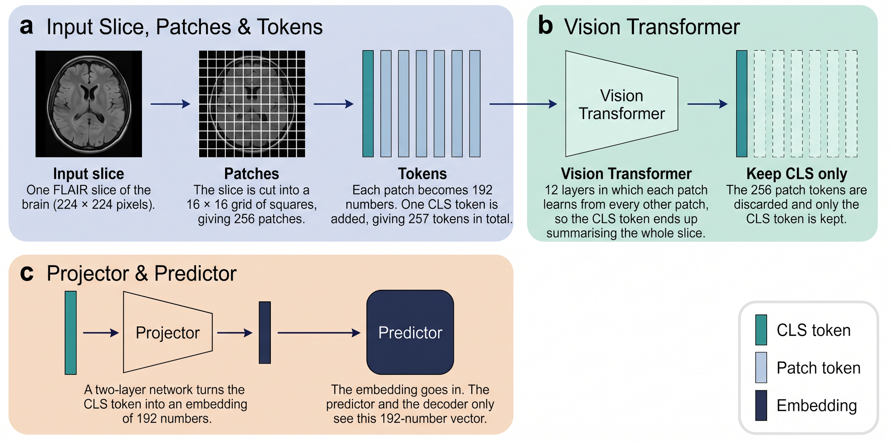
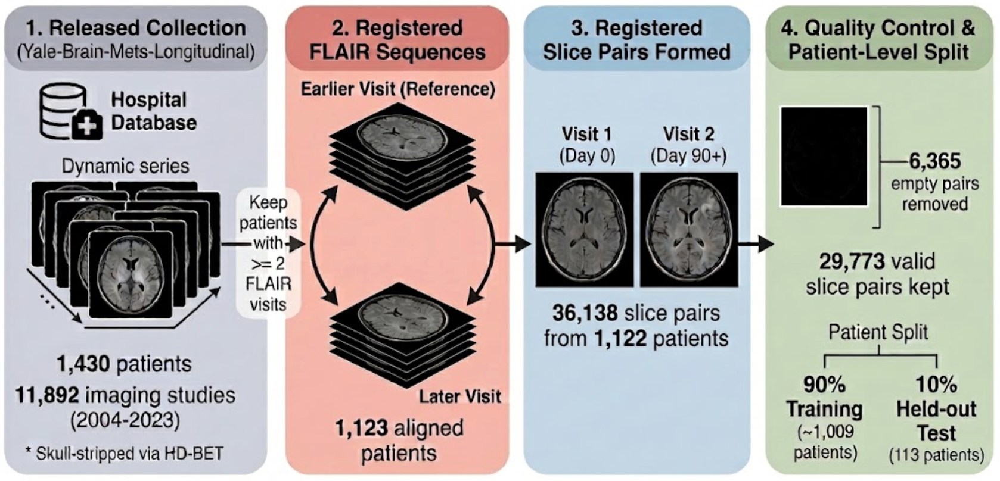
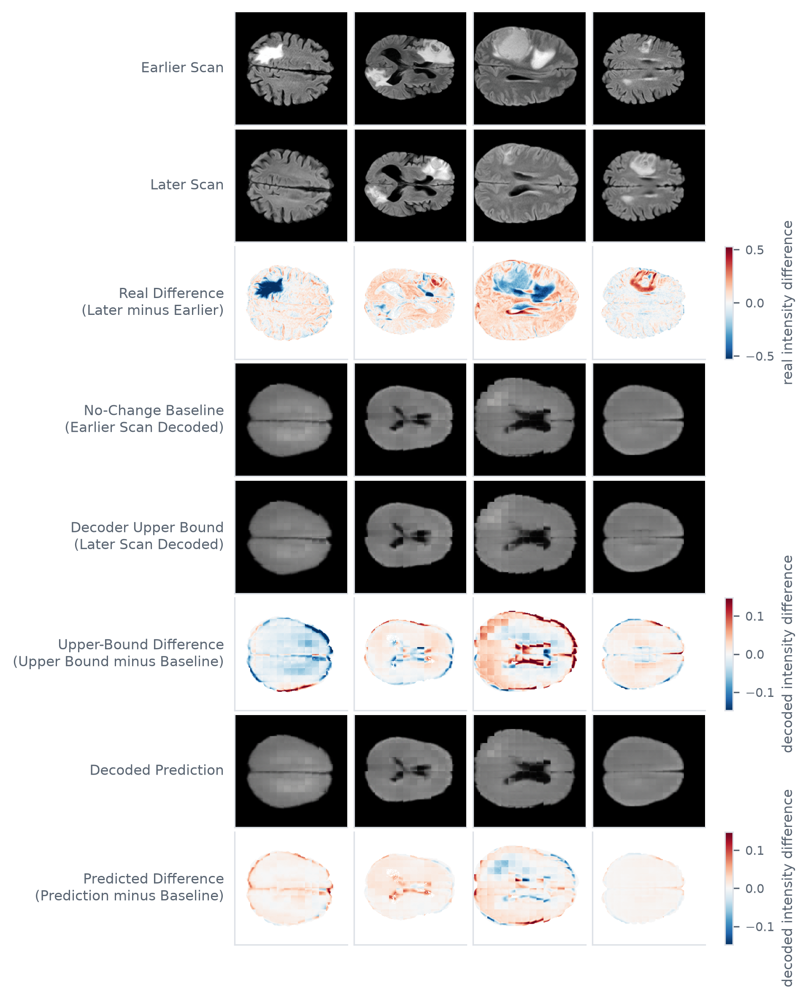

<h1 align="center">Longitudinal Prediction of Radiological Biomarkers using JEPA Models</h1>

<p align="center">
  <a href="requirements.txt"></a>
  <a href="requirements.txt"></a>
  <a href="https://doi.org/10.7937/3YAT-E768"></a>
  <a href="LICENSE"></a>
</p>



*Figure 2 | Path of a FLAIR slice to its 192-dimensional embedding.*

This work adapts LeWorldModel to longitudinal MRI of patients with brain metastases. The predictor is kept as it is, but instead of the robot's action, it gets the time between the two scans. The model gets one slice of an earlier MRI scan and predicts the embedding of the same slice in the later scan. The image is not reconstructed during training. A decoder is trained afterwards separately to turn the embeddings back into images and show what information they keep.

The research question is: How much information about the change between two examinations can a joint-embedding predictive model extract from longitudinal brain MRI without supervision?

## Data

All images come from the Yale-Brain-Mets-Longitudinal dataset, published on The Cancer Imaging Archive [8, 9]. This work uses the FLAIR images only.



*Figure 1 | Selection of patients and slice pairs.*

## Results

The embeddings captured information about slice position and coarse anatomy but the reconstruction experiments did not show that lesion information could be recovered by the decoder. Although the predicted changes increased with the time interval, they did not reproduce the real changes between visits. Overall, the results suggest that the model captures anatomical structure rather than the pathological changes needed to predict lesion progression.

<p align="center">
  
</p>

*Figure 6 | Real, decoded and predicted later visits for four held-out patients.*

## Code map

| Area | Entry points |
|---|---|
| Model | [`lewm_core/`](lewm_core/), [`train.py`](train.py) |
| Data | [`brain_mets/`](brain_mets/) |
| Configuration | [`config/train/`](config/train/), [`env.sh`](env.sh) |
| Evaluation | [`scripts/diagnostics/`](scripts/diagnostics/) |
| Cluster jobs | [`hpc/`](hpc/) |
| Trained weights | [`download_checkpoints.sh`](download_checkpoints.sh), [`checkpoints.sha256`](checkpoints.sha256) |
| Training logs | [`training_logs/`](training_logs/) |

## Getting started

The work is implemented in Python with PyTorch 2.13, Lightning 2.6.5 and transformers 4.57.6, using the stable-pretraining and stable-worldmodel packages released with LeWorldModel. Registration uses ANTsPy 0.6.3 and NiBabel 5.4.2.

**1. Installation**

```bash
git clone https://github.com/ozturkzey/longitudinal-jepa-brain-mets.git && cd longitudinal-jepa-brain-mets
module load Python/3.11.5     # RWTH cluster: the system python3.11 does not exist on the GPU nodes
python3.11 -m venv .venv && .venv/bin/pip install -r requirements.txt               # training, evaluation
python3.11 -m venv venv  && venv/bin/pip install -r requirements-registration.txt   # registration
```

**2. Data and paths**

| Input | Location |
|---|---|
| Yale-Brain-Mets-Longitudinal images [9] | [doi:10.7937/3YAT-E768](https://doi.org/10.7937/3YAT-E768) → `BRAINJEPA_RAW` in [`env.sh`](env.sh) |
| `Yale-Brain-Mets-Longitudinal_ClinicalData_20250605.xlsx` [9] | repository root |
| Radio-DINO [40] | `hf_hub:Snarcy/RadioDino-b16` |
| MRI-CORE [13] | `git clone https://github.com/mazurowski-lab/mri_foundation` → `mri_foundation/pretrained_weights/MRI_CORE_vitb.pth` |

**3. Trained weights**

```bash
bash download_checkpoints.sh     # release v1.0 → $STABLEWM_HOME/checkpoints/
```

**4. Preprocessing**

```bash
source env.sh
for p in $(ls "$BRAINJEPA_RAW"); do sbatch --export=ALL,PATIENT_ID=$p hpc/register.sbatch; done   # Section 3.2.1
sbatch hpc/registration_qc.sbatch                                                                  # Sections 3.3, 4.1
sbatch hpc/build_cache_volwin.sbatch                                                               # Sections 3.2.2, 3.2.3
sbatch hpc/build_all_visits_cache.sbatch                                                           # Section 3.7.2
```

**5. Figures and tables**

| Report | Command |
|---|---|
| Figure 3 | `source env.sh && venv/bin/python scripts/diagnostics/data/registration_qc.py --render YG_0Y74OO0HCJZA --slices 15,19,24` |
| Figure 4 | `.venv/bin/python scripts/diagnostics/prediction/plot_training_curves.py training_logs/encoder_volwin_4194822.txt figure4.png 70` |
| Table 4.1, Figure 5 | `sbatch hpc/slice_position_probe.sbatch` |
| Table 4.2 | `sbatch hpc/embedding_dimension.sbatch` |
| Table 4.3 | `sbatch --export=ALL,ARM=jepa hpc/pixel_table.sbatch` (`ARM=radiodino`, `ARM=mricore`) |
| Figure 6 | `sbatch hpc/pipeline_figure.sbatch` |
| Section 4.5 | `sbatch hpc/interval_eval.sbatch` |

<details>
<summary><b>Training from scratch</b></summary>

```bash
sbatch --export=ALL,CONFIG=<config> hpc/train.sbatch
```

| Stage | Config | Checkpoint |
|---|---|---|
| JEPA encoder | `brain_mets_encoder_volwin` | `weights_epoch_71.pt` |
| JEPA predictor | `brain_mets_predictor_volwin_e71` | `weights_epoch_5.pt` |
| JEPA decoder | `brain_mets_decoder_volwin_e71` | `weights_epoch_120.pt` |
| Radio-DINO projector and predictor | `brain_mets_setupB_radiodino_matched` | `weights_epoch_18.pt` |
| Radio-DINO decoder | `brain_mets_decoder_radiodino_matched` | `weights_epoch_80.pt` |
| MRI-CORE projector and predictor | `brain_mets_setupB_mricore_matched` | `weights_epoch_32.pt` |
| MRI-CORE decoder | `brain_mets_decoder_mricore_matched` | `weights_epoch_95.pt` |
| Radio-DINO projector, 192 dimensions (Table 4.2) | `brain_mets_setupB` | `weights_epoch_21.pt` |
| Radio-DINO decoder, 768 dimensions (Table 4.2) | `brain_mets_decoder_radiodino768` | `weights_epoch_110.pt` |
| Radio-DINO decoder, 192 dimensions (Table 4.2) | `brain_mets_decoder_radiodino192` | `weights_epoch_80.pt` |

</details>

## References

[8] Chadha S, Weiss D, Janas A, Ramakrishnan D, Hager T, Osenberg K, et al. (2025). An 11,000-study open-access dataset of longitudinal magnetic resonance images of brain metastases. arXiv:2506.14021.

[9] Chadha S, Weiss D, Janas A, Ramakrishnan D, Hager T, Osenberg K, et al. (2025). Yale longitudinal dataset of brain metastases on MRI with associated clinical data (Yale-Brain-Mets-Longitudinal) (Version 1) [Data set]. The Cancer Imaging Archive. doi:10.7937/3YAT-E768.

[13] Dong H, Chen Y, Gu H, Konz N, Chen Y, Li Q, et al. (2025). MRI-CORE: a foundation model for magnetic resonance imaging. arXiv:2506.12186.

[30] Maes L, Le Lidec Q, Scieur D, LeCun Y, Balestriero R (2026). LeWorldModel: stable end-to-end joint-embedding predictive architecture from pixels. arXiv:2603.19312.

[40] Zedda L, Loddo A, Di Ruberto C (2025). Radio DINO: a foundation model for advanced radiomics and AI-driven medical imaging analysis. Computers in Biology and Medicine 195: 110583. doi:10.1016/j.compbiomed.2025.110583

## License

Code: [MIT](LICENSE), based on [LeWorldModel](https://github.com/lucas-maes/le-wm) [30]. Data: CC BY 4.0, not included [9].
